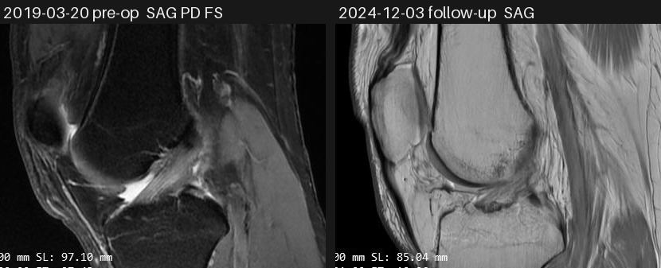
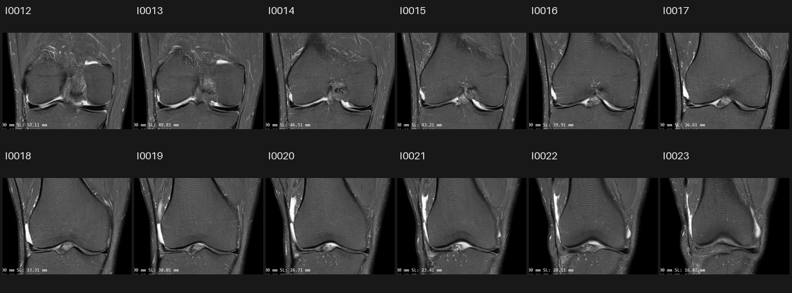
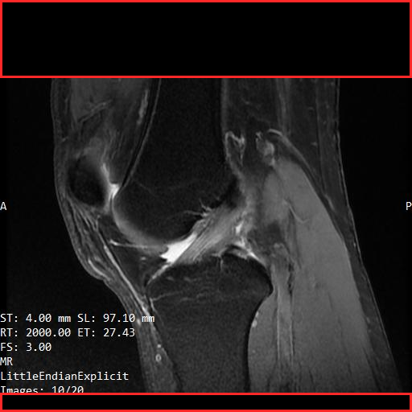

# knee-mcp

**Let Claude or ChatGPT look at your own knee MRI / X-ray images** — straight from a Google Drive folder, with
burned-in patient details masked, over a private, authenticated MCP server.

[繁體中文說明 →](README.zh-TW.md)

> ⚠️ knee-mcp is an image viewer for patients, not a medical device. What an AI says about your images is not a
> diagnosis. Talk to your doctor.

## Why

Patients usually get their scans as a hospital CD or a folder of JPEGs. Asking an AI "what changed in my knee
between 2019 and 2024?" means uploading dozens of images by hand, one chat at a time — and every image carries your
name, chart number and birth date. knee-mcp turns the folder into a set of tools the AI can browse on its own:
list the exams, open a series as a contact sheet, zoom into a slice, compare two dates side by side.

It was built for one real case (see [the case study](docs/case-study.zh-TW.md)): a right knee with a 2018 X-ray, a
2019 pre-op MRI, a 2023 X-ray and a 2024 follow-up MRI from two hospitals, 438 images in all.

## What you get

| Tool | Returns |
|---|---|
| `list_studies()` | exams found: date, hospital, type, number of series and images, plus naming issues |
| `list_series(study)` | per series: image count, plane / sequence (e.g. `SAG PD FS`), slice-location range |
| `get_contact_sheet(study, series)` | one image: the whole series as numbered thumbnails |
| `get_slice(study, series, index, crop, zoom)` | one image + a caption line (plane, SL, ST, masked boxes) |
| `get_slices(study, series, start, end)` | up to 8 neighbouring slices |
| `compare(a, b)` | two slices side by side, labelled with date and image number |

- Images are real MCP `ImageContent` (PNG), never base64 pasted into text, and each response stays under the 1 MiB
  MCP message limit.
- Works with **claude.ai** custom connectors, **ChatGPT** developer-mode connectors (both via OAuth), **Claude Code**
  and the **MCP Inspector** (bearer token).

## Screenshots

All images below are the author's own knee, masked by knee-mcp and shared with consent.

**`compare`** — the 2019 pre-op MRI next to the 2024 follow-up, same plane:



**`get_contact_sheet`** — neighbouring coronal slices of the 2024 MRI, numbered so the AI can ask for any of them:



**Masking** — a full 2019 frame as returned, with the blacked-out areas outlined in red (`prebuild --debug-overlays`).
The top band held the name, chart number and birth date; the technical parameters at the lower left stay visible:



## How it works

```
Google Drive folder (drive.readonly, one folder only)
        │  JPEG / PNG named by a simple rule, or raw DICOM from a hospital CD
        ▼
python -m knee_mcp.prebuild      ← offline, incremental (fileId + modifiedTime)
        │  1. read plane / SL / ST (OCR, or DICOM tags)
        │  2. mask personal data (hospital edge bands + OCR of names, IDs, dates)
        │  3. store masked PNG + manifest.json   (originals are never written to disk)
        ▼
MCP server (Streamable HTTP, OAuth or bearer token)
        │  tools only read the prebuilt cache: answers in ~0.1–3 s
        ▼
Claude / ChatGPT
```

- **Files:** JPEGs named `{YYYY-MM-DD}[_{HOSPITAL}]_RK_[XR_][S{series}_]I{image}.jpg`, or a hospital CD's DICOM files
  as they are (date, series and image number come from the DICOM tags; patient tags are never read out).
- **Masking:** only two kinds of area are blacked out — the hospital's edge text bands (templates) and text boxes at
  the edges whose content looks like personal data (Chinese names, chart / ID numbers, dates, physician names).
  The anatomy is never masked; suspicious text inside the image area is flagged for owner review instead.
  Every masked box can be checked with `prebuild --debug-overlays`.
- **Security:** single owner. Bearer tokens for CLI clients, a small built-in OAuth server (dynamic client
  registration + PKCE, password page) for claude.ai / ChatGPT. Read-only Drive scope, one root folder.

### Masking: please read

OCR-based masking cannot be perfect. During development on the real case it **missed a birth date written with a
full month name** on X-rays that had no edge-band template, and earlier versions blacked out parts of the tibia.
Both are fixed and covered by tests, but **check the debug overlays for your own hospital's layout before relying
on it**, and add a template for your hospital (`knee_mcp/templates.py` or `KNEE_MASK_TEMPLATES`). For private use on
your own data you can turn masking off (`KNEE_MASKING=0`).

## Quick start

Requirements: Python 3.10+, [Tesseract OCR](https://github.com/tesseract-ocr/tesseract) with `eng` and `chi_tra`.

```bash
git clone https://github.com/jungkang0911/knee-mri-mcp.git && cd knee-mri-mcp
python -m venv .venv && . .venv/bin/activate       # Windows: .\.venv\Scripts\Activate.ps1
pip install -e ".[test]"
cp .env.example .env                                # fill in the values below
python -m knee_mcp.google_login                     # or use a Google service account
python -m knee_mcp.prebuild --debug-overlays ./debug
python -m knee_mcp                                  # serves http://127.0.0.1:8765/mcp
```

Minimum `.env`:

```ini
KNEE_ROOT_FOLDER_ID=<your Drive folder id>
GOOGLE_SERVICE_ACCOUNT_FILE=/path/to/service-account.json   # or GOOGLE_CLIENT_SECRETS + google_login
KNEE_PUBLIC_URL=https://knee.example.com
KNEE_BEARER_TOKENS=<python -m knee_mcp --gen-token>
KNEE_OWNER_PASSWORD=<long password for the OAuth page>
KNEE_OCR_LANGS=eng+chi_tra
```

Then expose it over HTTPS (Cloudflare Tunnel or Tailscale Funnel) and add `https://knee.example.com/mcp` as a
connector. Step-by-step instructions — Google Cloud service account, Windows and Ubuntu (systemd) deployment, every
setting, claude.ai / ChatGPT / Claude Code setup — are in [docs/setup.zh-TW.md](docs/setup.zh-TW.md) (Traditional
Chinese).

## Development

```bash
pytest -q        # ~60 tests: mock Drive, synthetic images with fake PII, synthetic DICOM, OAuth flow
```

The tests never touch real data: they burn fake names, chart numbers and birth dates into synthetic knee images
and check that OCR cannot read them back, that anatomy pixels are unchanged, and that every response fits in one
MCP message.

## Status

Built for and used on one person's real data. Contributions welcome — especially mask templates for other
hospitals' overlay layouts, and reports of anything the masking misses (please never attach a real image).

## License

[MIT](LICENSE)
